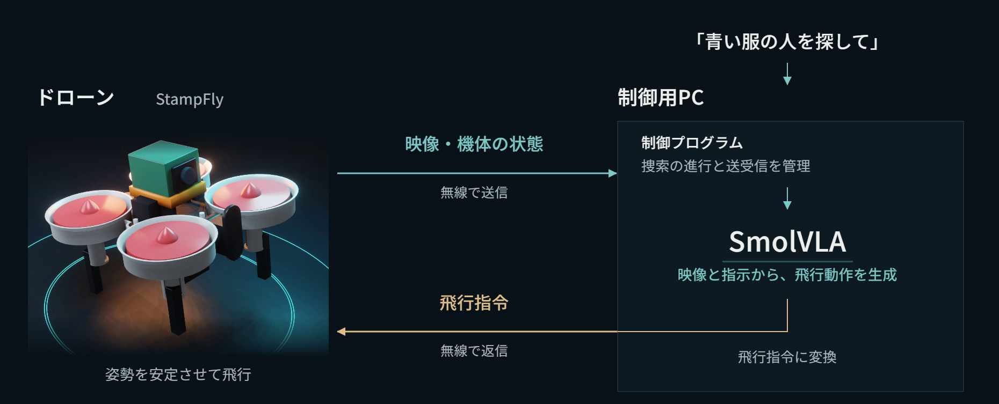

# 災害救助ドローン

言葉による指示で捜索を任せ、操縦の負担を減らす小型ドローンを、シミュレーターで制作しました。「青い服の人を探して」と伝えると、ドローンが離陸して室内を見回し、対象者を見つけて前まで近づいて止まり、確認画像を残して着陸します。飛行動作は、ドローン向けに追加学習したSmolVLAが、カメラ画像と言葉の指示から生成します。

説明資料：[docs/report_v1.1.pdf](docs/report_v1.1.pdf)（3ページ）

## まず、保存済みの記録を確認する

最終試験の26回の飛行は、Python 3.11以降とNumPyだけで採点し直せます。GPU、シミュレーター、Blender、モデルの重みは要りません。

1. [Release v1.1.0](https://github.com/curio184/pai2026/releases/tag/v1.1.0) から `v11_flight_records.zip` を取得して展開する
2. 次のコマンドを実行する

```powershell
python -m venv .venv
.venv\Scripts\python -m pip install numpy
.venv\Scripts\python verify_v11.py --records <展開したフォルダ>
```

Linux/macOSでは `.venv/bin/python` に読み替えてください。各記録を一時フォルダにコピーし、保存済みの採点結果を除いてから採点し直します。計算し直した成否と停止の継続時間が、このリポジトリに保存した採点結果と一致すれば `all_match: true` になります。元の記録は書き換えません。**これは保存済みの記録の採点の確認で、新しい飛行やモデルの推論は行いません。**

## 仕組み

### 機体と制御用PCのやり取り



実機は、小型ドローンStampFlyに、カメラと無線通信を担うXIAO ESP32S3 Senseと位置推定用のセンサーを載せ、GPU搭載PCと無線でつなぐ構成を想定しています。今回は、この構成（総質量50g）をシミュレーターで再現しました。機体の運動はMuJoCo、カメラ画像はBlenderで作り、飛行制御は無改変のArduPilot（SITL）が行います。

| 担当 | 役割 |
| --- | --- |
| 制御プログラム | 工程ごとに完了を判断して次へ進め、SmolVLAへの指示を切り替える |
| SmolVLA | 画像と指示、機体の状態から、指定された人に近づいて止まるまでの動作を生成する |
| ArduPilot | VLAの速度指令に従うように、機体の姿勢とモーターを制御する |
| SSDlite＋色判定 | 画像から人を検出し、服の色で対象者かどうかを見分ける。3枚続けて見つかれば発見とし、制御プログラムに知らせる |

利用者の「青い服の人を探して」という指示は制御プログラムが受け取り、「青い服の人に近づいて止まって」のような工程ごとの指示に置き換えてVLAに渡します。VLAへの指示は英語です。離陸・旋回・着陸は通常の制御で行います。

### 飛行動作の学習

SmolVLA（`lerobot/smolvla_base`）の画像と言葉を理解する部分は固定し、動作を生成する部分だけを追加学習しました。教師データの入力はカメラ画像、言葉の指示、機体の状態で、出力は前後・左右・上下の速度と旋回の速さを0.1秒刻みで32ステップ（3.2秒分）並べたアクションチャンクです。

- 教師動作は、シミュレーター内の人物と機体の位置からプログラムで計算しました。人物の位置を使うのは教師動作の計算だけで、飛行中のVLAには渡しません。
- 位置を覚えるだけでは正しく動けないように、人物の配置（20通り）、機体の位置と向き（人物から0.4〜4.0m）、服の色（立ち位置はそのままで入れ替えた組）を変えました。
- 学習画像は8,408枚で、うち6,000枚（3,000組）が服の色を入れ替えた組です。
- 最終モデルの学習設定は `v11_color/protocol/train16_english.json`、学習処理は `v11_color/scripts/train16_en.py`、データ作成は `v11_color/scripts/build_dataset16_en.py` です。学習は段階的に繰り返しており、途中の版の設定と記録も `v11_color/protocol/` と `v11_color/ALL_TRIALS*.md` に残しています。

## 現場を想定した試験

撮影してから動作が機体に届くまでの遅れを0.2秒と想定し、すべての試験に入れました。シミュレーターでは描画と推論の間は物理計算を止め、撮影からちょうど0.2秒後に動作が届くようにしています（`v11_color/runtime_rebuild05/fixed_latency.py`）。VLAの動作は書き換えず、届いたアクションチャンクの3ステップ目から実行し、0.2秒後に次のチャンクへ切り替えます。

| 想定した状況 | 試験の方法 | 結果 |
| --- | --- | --- |
| 煙や粉じんで視界が悪い | 動画と同じ人物配置で、薄い霧・濃い霧・粉じんの中、青い服の人を探す（学習データにない条件） | 3回中2回成功 |
| 人がどこにいるか分からない | 学習に使っていない4つの配置で、青い服の人と赤い服の人を探す。開始位置（±5cm）と向き（±5度）を変えて各配置4回 | 16回中16回成功 |
| 探す相手が指示で変わる | 同じ画像のまま、「青い服の人」「赤い服の人」と指示だけを入れ替える（32枚×2つの指示） | 64回中64回、指示した人の方へ向かった |

- 捜索の成功は、対象者の発見、接近と停止、確認画像の保存、着陸をすべて終えた場合です。停止は、人物の0.9m手前の目標点から25cm以内で、水平速度0.08m/s以下の状態が3秒以上続いたかで判定しました。
- 未学習の4配置（`v11_color/protocol/rebuild05_layouts.json`）は試験の前に無作為に用意し、学習にも開発中の調整にも使っていません。試験の条件と合格の基準は、飛行前に `v11_color/protocol/rebuild05_final.json` に登録しました。
- 薄い霧の1回は、目標点から10cmのところまで近づきましたが、止まっていた時間が2.8秒で3秒に届きませんでした。通常の視界での捜索（青・赤）と、見回しを含まない接近と旋回の飛行はすべて成功しました。
- 検証は1つの部屋と同じ2人に限られ、人物は動きません。飛行はすべてシミュレーターで行い、部品の搭載や電源、無線通信、実機での飛行は検証していません。遅れの0.2秒は想定した値で、実機で測ったものではありません。

全26回の一覧は [v11_color/TRIALS_REBUILD04_05.md](v11_color/TRIALS_REBUILD04_05.md)、集計は [v11_color/results/rebuild05_summary.json](v11_color/results/rebuild05_summary.json) です。

## 試験の経過

最終試験（rebuild05）に至るまでの経過も、失敗を含めて残しています。

1. **追従制御を使った構成（rebuild03）**：VLAの動作列から停止位置を読み取り、別の制御で機体を運ぶ構成。このときの遅れは、シミュレーターの描画の待ち時間を含めて約0.9秒あった。記録は `v11_color/ALL_TRIALS_REBUILD03.md`。
2. **遅れ0.4秒・VLAの動作をそのまま実行（rebuild04）**：描画の待ち時間を遅れから外し、追従制御をやめた。未学習の配置15/16、動画の場面7/9で、登録した基準（動画の場面9/9）に届かなかった。失敗は、目標点の近くで速度が細かく揺れ、3秒の停止が続かなかったもの。
3. **遅れ0.2秒（rebuild05、最終）**：遅れの想定を0.2秒に変え、新しく用意した未学習の4配置で試験し直した。結果は上の表のとおり。

rebuild04とrebuild05の全飛行は [v11_color/TRIALS_REBUILD04_05.md](v11_color/TRIALS_REBUILD04_05.md) に、それ以前の開発の記録は `v11_color/ALL_TRIALS*.md` にあります。

## 動画との関係

提出した動画は、最初に提出した版（v1.0.0）の構成で撮影しました。その後の試験で構成を変えたため、動画の画面に出ている値と、この資料の結果には次の違いがあります。

- 動画のVLA入力画像の下には、撮影からの経過時間（1〜2秒）が表示されています。最終試験では、遅れを0.2秒と想定して試験し直しました。
- 動画ではVLAが離陸・着陸の要求も出していますが、最終の構成では離陸・旋回・着陸は通常の制御で行います。
- 動画の薄い霧の場面は成功した飛行ですが、最終試験の薄い霧の1回は、停止が3秒に届かず失敗でした。

最初の版のREADMEは [docs/README_v1.0.md](docs/README_v1.0.md) にあり、`verify.py` でその版の5件の記録も確認できます。

## ファイルの案内

| 場所 | 内容 |
| --- | --- |
| `verify_v11.py` | 最終試験26回の採点の確認（記録はRelease v1.1.0のZIP） |
| `v11_color/runtime_rebuild05/` | 最終試験の飛行プログラム（`search_mission.py`、`fixed_latency.py`、`search_worker.py` など） |
| `v11_color/scripts/` | データ作成、学習、試験の実行、採点、集計の処理 |
| `v11_color/protocol/` | 試験の条件、配置、学習設定（飛行前に登録したもの） |
| `v11_color/runs/` | 各飛行の採点結果、工程、遅れの記録、確認画像（軌跡と入力画像の全体はRelease v1.1.0） |
| `v11_color/probe_rebuild05/` | 指示の入れ替え検査の画像と出力 |
| `v11_color/results/` | 集計 |
| `v11_color/report/` | 説明資料の組版処理 |
| `v11_color/PUBLICATION_PROVENANCE_v1.1.json` | 公開時に個人のパスを置き換えたファイルと、置き換え前後のハッシュ |
| [出典と利用条件](docs/THIRD_PARTY.md) | 素材・ソフトウェア・音声の出典 |

モデルの重み、学習画像、Blenderのシーン、ArduPilotのバイナリログは含めていません。公開にあたり、テキストファイル中のローカルのパスは `<PROJECT_ROOT>` などに置き換えています。そのため、試験の条件に記録したハッシュは、置き換え前のファイルのものです。

## 利用条件

第三者由来のファイルには各ライセンスが適用されます。独自コード全体について新しいオープンソースライセンスは付与していません。著作権表示・利用条件は[出典と利用条件](docs/THIRD_PARTY.md)をご確認ください。
