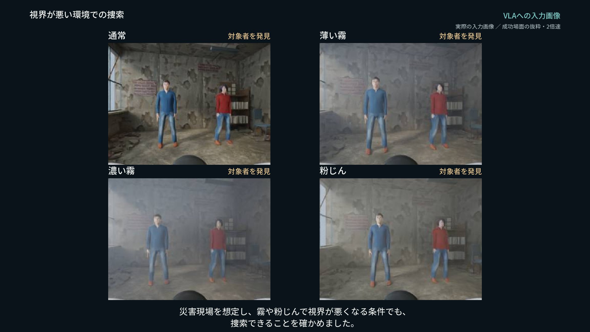
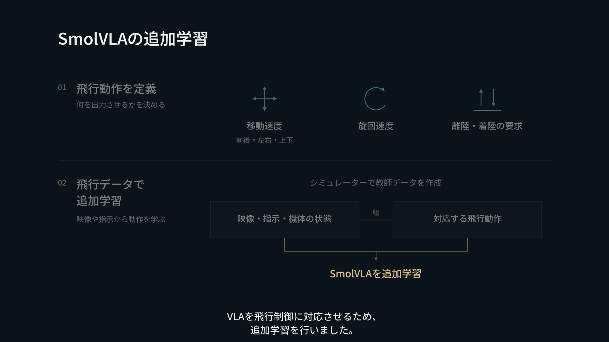

# 災害救助ドローン

> 最初に提出した版（v1.0.0）のREADMEです。現在の内容は[トップのREADME](../README.md)を参照してください。

言葉による指示とカメラ映像から飛行動作を生成し、指定された人物を探すドローンのシミュレーションです。SmolVLAにドローンの動作を追加学習し、離陸・見回し・人物の発見・接近と停止・確認画像の保存・着陸までを実行しました。

通常の環境で青い服と赤い服の人物を探す実演に加え、霧や粉じんを含む4つの視界条件で、青い服の人物の捜索を確認しています。



## まず、保存済みの記録を確認する

Python 3.11以降とNumPyだけで、5件の飛行記録を再採点できます。GPU、Blender、モデル重み、APIキーは不要です。

```powershell
python -m venv .venv
.venv\Scripts\python -m pip install -r requirements-verify.txt
.venv\Scripts\python verify.py
```

Linux/macOSでは`.venv/bin/python`に読み替えてください。`success: true`、各ケースの`score_matches: true`、`total_input_images: 386`が確認結果です。

配布ファイルのハッシュを確認した後、一時フォルダーに記録をコピーし、既存の物理スコアを使わずにログから再計算します。元の記録は書き換えません。**これは保存済みの記録の検証であり、新しい飛行やVLA推論を実行するものではありません。**

## 仕組み

1. 利用者が「青い服の人を探して」などの任務を伝えます。
2. 任務を管理するプログラムが、離陸・見回し・接近・報告・着陸の工程を進めます。
3. SmolVLAが、カメラ画像・工程の指示・機体の状態から動作列を生成します。
4. 制御プログラムが動作を飛行指令に変換し、ArduPilotが機体の姿勢と飛行を制御します。
5. MuJoCoで物理状態が更新され、Blenderで描画した次のカメラ画像を受け取ります。

人物の発見はSSDliteによる人物検出と服の色、連続した3画像での確認を使います。任務全体の計画や人物判定を、VLAだけで行う構成ではありません。実行時のVLA・人物判定・任務進行には、人物の正解座標や目標距離を渡しません。シミュレーターの真値はカメラ描画・センサー合成と飛行後の採点に利用します。

## SmolVLAの追加学習

入力は320×240のRGB画像、言語指示、9次元の機体状態です。出力は前後・左右・上下の速度、旋回速度、離陸要求、着陸要求の6次元で、32ステップの動作列を生成します。動作表現と教師データをドローン用に用意し、画像エンコーダーを固定して、動作生成に関係する部分とテキスト層の一部を追加学習しました。

外観に対応する5,000ステップの学習後、停止精度を改善する4,000ステップの追加学習を実施しました。ゼロから学習したモデルではありません。設定と記録は`finetune_plan_realism_precision_02.json`、`outputs/smolvla_training_realism_precision_02/`、`outputs/vla_data_realism_precision_02/`にあります。



## 検証結果

| 対象 | 視界条件 | 発見・接近と停止・画像保存・着陸 | 記録 |
| --- | --- | --- | --- |
| 青い服 | 通常 | 成功 | [clear_blue](../rescue_search/runs/eval03/clear_blue/search_score.json) |
| 青い服 | 薄い霧 | 成功 | [fog_light_blue](../rescue_search/runs/eval03/fog_light_blue/search_score.json) |
| 青い服 | 濃い霧 | 成功 | [fog_dense_blue](../rescue_search/runs/eval03/fog_dense_blue/search_score.json) |
| 青い服 | 粉じん | 成功 | [dust_blue](../rescue_search/runs/eval03/dust_blue/search_score.json) |
| 赤い服 | 通常 | 成功 | [clear_red](../rescue_search/runs/eval_red01/clear_red/search_score.json) |

いずれも1室・固定した人物配置での各1回の最終確認です。一般的な成功率や未知の部屋での探索能力を示す統計ではありません。霧や粉じんはモデルへの入力画像にも反映されていますが、実際の視程や粒子特性に校正したものではありません。

対象への接近は、目標付近25cm以内、水平速度0.08m/s以下、3秒以上の停止などを判定します。離陸、ホバリング、着陸後のモーター停止、原画像の保存も記録から確認します。採点処理は[score_mission.py](../score_mission.py)と[score_search.py](../rescue_search/score_search.py)です。

## 実機への展開

実在する小型機StampFlyを基に、カメラと制御用PCを組み合わせた構成を検討しています。映像と飛行指令を無線でやり取りし、モデルの計算はPC側で行う設計です。

実機への搭載・電源・通信・飛行は未検証です。シミュレーションは総質量50gという設計条件であり、実機に合わせて実測校正したデジタルツインではありません。災害現場での実用性や安全性を検証済みとはしていません。

## ファイルの案内

| 場所 | 内容 |
| --- | --- |
| `verify.py` | 原本を書き換えない5件の記録検証 |
| `rescue_search/search_worker.py` | SmolVLA推論と人物検出 |
| `rescue_search/search_mission.py` | 任務進行と飛行指令 |
| `smolvla_policy.py`, `vla_link.py`, `rescue_search/search_link.py` | モデルと制御系の接続 |
| `ardupilot_bridge/` | ArduPilotとMuJoCoの接続・構築用ソース |
| `rescue_search/runs/` | 最終5件のログ、実入力画像、採点結果、実行時ソースの記録 |
| `rescue_search/scenes/` | 物理シーン。Blenderファイルは別添のシーンZIP |
| `finetune_smolvla.py`, `finetune_revision.py` | 学習処理 |
| `rescue_search/consistent_narration.py`, `rescue_search/conditions_quad.py` | 最終動画の編集処理と4分割表示 |
| `docs/video/` | 最終177秒版の編集計画、採用記録、音声情報 |
| [再現手順](REPRODUCING.md) | 保存記録の検証と新規飛行の違い、追加の準備 |
| [出典と利用条件](THIRD_PARTY.md) | 素材・ソフトウェア・音声の出典 |
| `DISTRIBUTION_MANIFEST.json` | 公開候補の全ファイルのSHA-256（一覧自身を除く） |

動画は2分57秒です。実演の倍速部分には速度を表示しています。4分割映像は各条件の独立した飛行記録を、確認画像の保存に至る場面にそろえて並べたものです。外部カメラ映像は実測ログに基づく再描画、VLA入力画像は保存した原JPEGです。映像の視覚表現と成功判定を混同しないため、元画像と記録を同梱しています。

## 利用条件

第三者由来のファイルには各ライセンスが適用されます。独自コード全体について新しいオープンソースライセンスは付与していません。著作権表示・利用条件は[出典と利用条件](THIRD_PARTY.md)をご確認ください。
